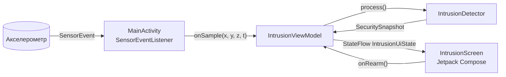
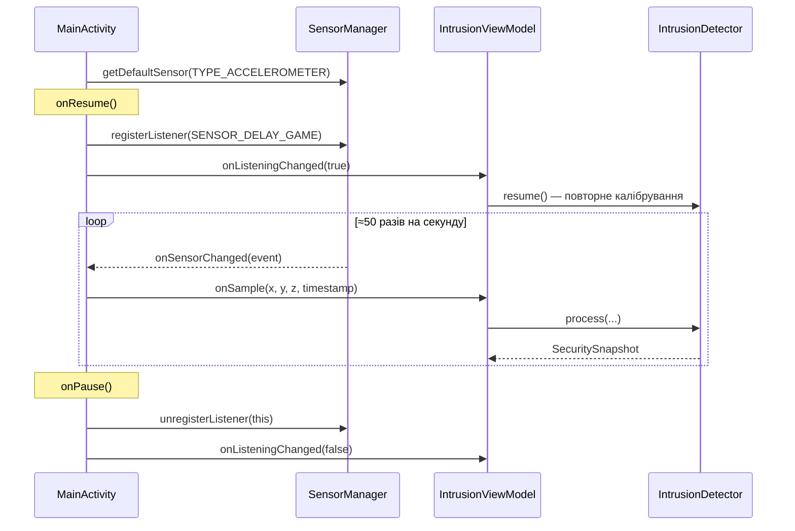
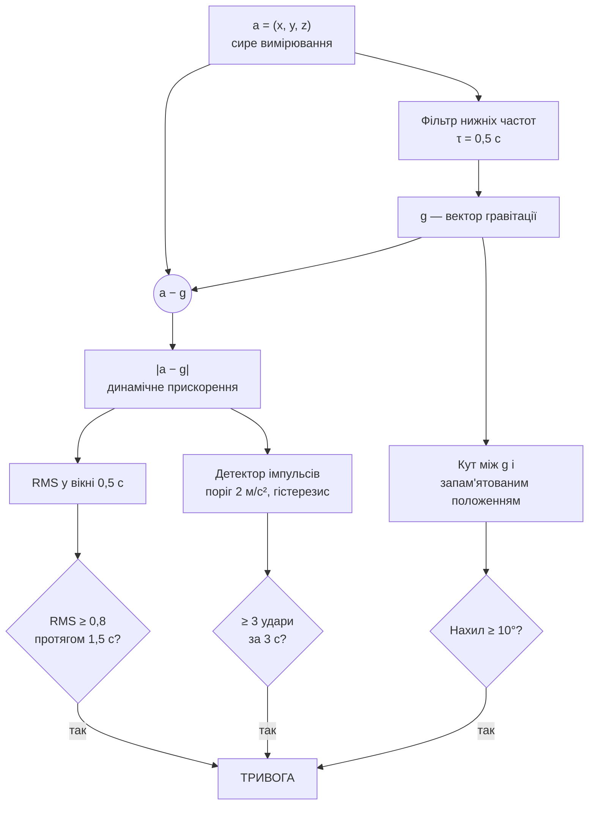
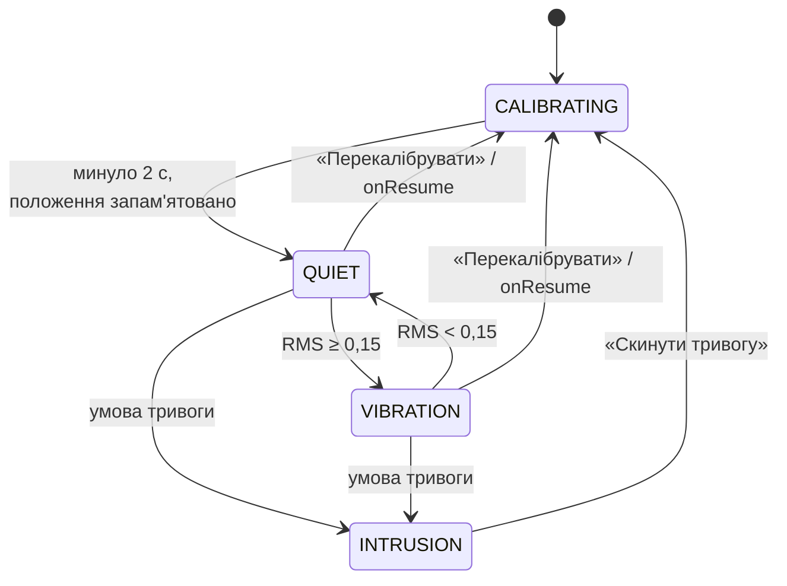
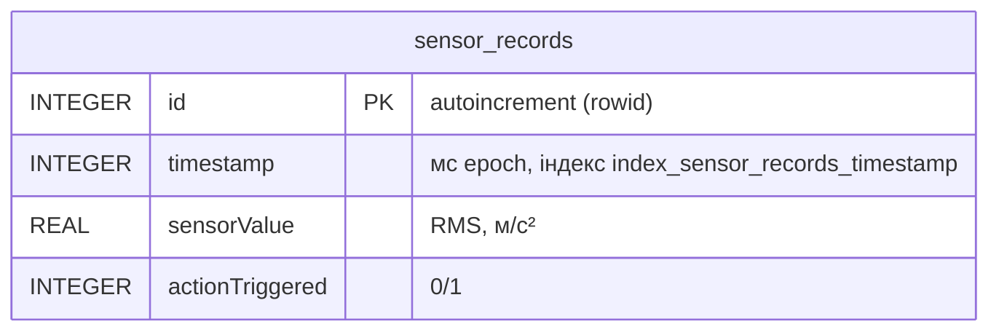
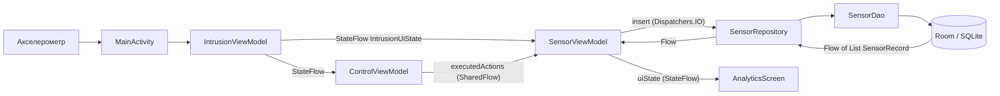
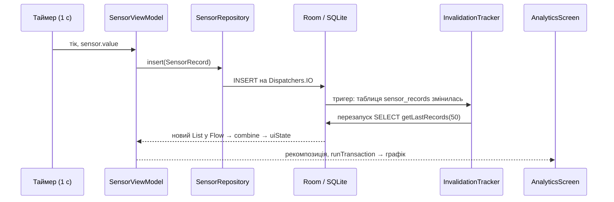
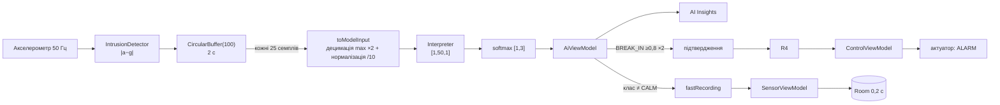

# Intrusion Detector

Android-застосунок, який перетворює смартфон на датчик вторгнення. Телефон кладуть на поверхню (полицю, підвіконня, сейф) або кріплять на двері, і він через акселерометр стежить за вібрацією, ударами та зміною положення. Якщо двері відчинили, у них стукають або телефон зсунули, вмикається тривога.

> Лабораторна робота №1 з курсу мобільної розробки, варіант 13: моніторинг вібрації поверхонь.
> Виконала Покорна Надія.

## Можливості

- Зчитування акселерометра через `SensorManager` з частотою ≈50 Гц
- Відображення X, Y, Z у реальному часі з індикаторами по кожній осі
- Індикатор положення у вигляді «рівня» з межею допустимого нахилу
- Шкала рівня вібрації та графік сигналу за останні ~3 с
- Три незалежні умови тривоги: серія ударів, тривала вібрація, зміна нахилу
- Журнал подій
- Зупинка зчитування в `onPause` для економії батареї
- Збереження стану при повороті екрана
- Unit-тести алгоритму без емулятора

## Технології

| | |
|---|---|
| Мова | Kotlin 2.0 |
| UI | Jetpack Compose, Material 3 |
| Min SDK | 31 (Android 12) |
| Target SDK | 35 |
| Стан | ViewModel + StateFlow |
| Тести | JUnit 4 |
| Локальна БД | Room + KSP |
| Графіки | Vico |
| ML | TensorFlow Lite 2.17, власна 1D-CNN (навчання: Python 3.12, TensorFlow 2.17) |

## Структура проєкту

```
app/src/main/java/com/example/intrusiondetector/
├── MainActivity.kt            # SensorManager, SensorEventListener, життєвий цикл
├── IntrusionViewModel.kt      # стан екрана, журнал подій
├── actuator/
│   ├── Actuators.kt           # SmartActuator (вібрація, ліхтарик), DecisionEngine (ЛР4)
│   └── ControlViewModel.kt    # авто/ручне/хмарне керування, журнал
├── ml/
│   ├── ActivityClassifier.kt  # TFLite Interpreter, CircularBuffer, препроцесинг, selfTest (ЛР6)
│   └── AiViewModel.kt         # вікно семплів, inference на Default, підтвердження аномалії (ЛР6)
├── ble/
│   ├── Ble.kt                 # UUID хаба, BleDevice, BleState, IBleConnector
│   ├── MockBle.kt             # імітація сканера і з'єднання (ЛР2)
│   └── HubViewModel.kt        # стан вкладки «Хаб BLE», автовідправка тривоги
├── sensor/
│   └── IntrusionDetector.kt   # алгоритм виявлення (чистий Kotlin, без Android)
├── storage/
│   ├── SensorStorage.kt       # Room: SensorRecord, SensorDao, AppDatabase, SensorRepository (ЛР5)
│   └── SensorViewModel.kt     # запис у БД раз на 1 с (0,2 с при AI-активності) і події актуаторів
└── ui/
    ├── AppRoot.kt             # нижня навігація: «Детектор» / «Хаб BLE» / «Керування» / «Аналітика»
    ├── AnalyticsScreen.kt     # статус запису, графік Vico, спрацювання актуаторів (ЛР5)
    ├── ControlScreen.kt       # лампа, ліхтарик, тривога, авто-режим, журнал (ЛР4)
    ├── IntrusionScreen.kt     # екран на Compose, блок «AI Insights» (ЛР6)
    ├── HubScreen.kt           # пошук, підключення, термінал, дозволи
    └── theme/Theme.kt         # кольори станів і осей

app/src/main/assets/
└── vibration_classifier.tflite  # модель ЛР6 (результат ml/train_model.py)

ml/
├── train_model.py             # генерація даних, навчання, конвертація, перевірка, звіт (ЛР6)
├── requirements.txt           # зафіксовані версії Python-пакетів
└── TRAINING.md                # звіт про навчання, генерується скриптом

app/src/test/java/com/example/intrusiondetector/
├── sensor/IntrusionDetectorTest.kt   # тести алгоритму на синтетичних сигналах
└── ble/MockBleTest.kt                # тести BLE-моку у віртуальному часі

app/schemas/com.example.intrusiondetector.storage.AppDatabase/
└── 1.json                     # схема БД версії 1, генерує Room під час збірки (ЛР5)
```

## Архітектура

Код розділений на три шари. Activity працює тільки з Android-сенсором і нічого не знає про логіку. Уся обробка сигналу живе в `IntrusionDetector`, у якому немає жодного імпорту з `android.*`, тому його можна тестувати звичайним JUnit. ViewModel з'єднує їх і переживає поворот екрана.



- **`MainActivity`** отримує `SensorManager`, реєструє слухача і передає `values[0..2]` та `timestamp` у ViewModel.
- **`IntrusionViewModel`** тримає детектор, історію сигналу для графіка (150 точок) і журнал подій (до 20 записів), публікує все це як `StateFlow`.
- **`IntrusionDetector`** на кожне вимірювання повертає `SecuritySnapshot`: значення осей, рівень вібрації, кут нахилу, стан і причину тривоги.
- **`IntrusionScreen`** просто малює те, що прийшло в стані.

## Життєвий цикл сенсора

Слухач реєструється в `onResume` і знімається в `onPause`, тому коли застосунок не на екрані, сенсор не працює і не витрачає батарею.



```kotlin
override fun onResume() {
    super.onResume()
    accelerometer?.let {
        // SENSOR_DELAY_GAME ≈ 50 Гц: достатньо, щоб помітити короткий удар
        sensorManager.registerListener(this, it, SensorManager.SENSOR_DELAY_GAME)
        viewModel.onListeningChanged(true)
    }
}

override fun onPause() {
    // Зупиняємо зчитування, коли застосунок не видно
    sensorManager.unregisterListener(this)
    viewModel.onListeningChanged(false)
    super.onPause()
}
```

Чому саме `SENSOR_DELAY_GAME`: на `SENSOR_DELAY_UI` (~16 Гц) короткий стук може потрапити між двома вимірюваннями і загубитися, а `SENSOR_DELAY_FASTEST` для цієї задачі зайвий.

Після повернення з фону положення калібрується заново, бо поки застосунок був на паузі, телефон могли перекласти. Але якщо тривога вже спрацювала, вона не скидається, інакше її можна було б «прибрати», просто згорнувши застосунок.

## Алгоритм виявлення

### Обробка сигналу

Сирий акселерометр показує не тільки рух, а й гравітацію: у спокої на горизонтальній поверхні Z ≈ 9,81 м/с². Тому сигнал спочатку розділяється на дві складові: повільну (гравітація, тобто положення) і швидку (вібрація).



**1. Виділення гравітації.** Фільтр нижніх частот першого порядку по кожній осі:

```
g ← g + α · (a − g),    α = dt / (τ + dt)
```

`dt` береться з різниці `event.timestamp`, а не константою, бо реальний інтервал між подіями «плаває» навіть при фіксованому `SENSOR_DELAY_*`.

**2. Динамічне прискорення.** `|a − g|` — це вібрація в будь-якому напрямку, незалежно від того, як лежить телефон.

**3. Рівень вібрації.** Середньоквадратичне значення `|a − g|` у ковзному вікні 0,5 с. Сума квадратів оновлюється інкрементно: нове значення додається, застарілі віднімаються, тому прохід по всьому вікну на кожну подію не потрібен.

**4. Імпульси (удари).** Удар фіксується, коли `|a − g|` перевищує 2 м/с². Після сильного удару сигнал ще кілька разів «дзвенить» вище порогу, тому стоїть два обмеження:
- гістерезис: наступний імпульс можливий лише після того, як сигнал впаде нижче 0,5 м/с²;
- мінімум 150 мс між імпульсами.

**5. Нахил.** Перші 2 секунди після постановки на охорону вимірювання усереднюються, і нормований вектор запам'ятовується як базове положення. Далі рахується кут між ним і поточним `g`:

```
θ = arccos( ĝ_base · ĝ_now )
```

### Стани системи



| Стан | Колір | Що означає |
|---|---|---|
| `CALIBRATING` | синій | запам'ятовується положення, тривоги не перевіряються |
| `QUIET` | зелений | поверхня нерухома |
| `VIBRATION` | жовтий | є вібрація, але умови тривоги ще не виконані |
| `INTRUSION` | червоний | тривога, утримується до ручного скидання |

### Порогові значення

Усі пороги зібрані в об'єкті `Thresholds` в `IntrusionDetector.kt`.

| Параметр | Значення | Звідки взялося |
|---|---|---|
| `VIB_WARN_RMS` | 0,15 м/с² | шум сенсора в спокої ≈ 0,01–0,08 |
| `VIB_ALARM_RMS` | 0,8 м/с² | легкі дотики, кроки поруч — до 0,8 |
| `SUSTAIN_NS` | 1,5 с | відкриття дверей триває довше за випадковий поштовх |
| `IMPULSE_PEAK` | 2,0 м/с² | стук у двері дає 2–10 |
| `IMPULSE_RESET` | 0,5 м/с² | гістерезис для імпульсів |
| `MIN_IMPULSE_INTERVAL_NS` | 150 мс | відсікає «дзвін» одного удару |
| `IMPULSE_COUNT` / `IMPULSE_WINDOW_NS` | 3 за 3 с | один-два випадкові удари не рахуються |
| `TILT_ALARM_DEG` | 10° | двері, що відчиняються, або зсунутий телефон |
| `GRAVITY_TAU_S` | 0,5 с | стала часу фільтра гравітації |
| `CALIBRATION_NS` | 2 с | час на запам'ятовування положення |

Пороги поки підібрані на емуляторі та тестових сигналах, на реальному пристрої їх ще треба буде уточнити.

## Інтерфейс

Екран складається з карток, усі графічні елементи намальовані на Compose `Canvas`:

1. **Статус** — кольоровий бейдж стану, причина тривоги, лічильник ударів, кнопка «Перекалібрувати» / «Скинути тривогу». Під час калібрування показується прогрес.
2. **Рівень вібрації** — шкала із зонами «тихо / вібрація / сильна» і маркером поточного RMS.
3. **Координати акселерометра** — X, Y, Z з двосторонніми індикаторами (вліво для від'ємних значень, вправо для додатних) у діапазоні ±2g, а також `|a|` і `|a − g|`.
4. **Положення поверхні** — «рівень»: кулька котиться в бік нахилу, кільце показує запам'ятоване положення, червоне пунктирне коло — межу тривоги 10°.
5. **Сигнал** `|a − g|` за ~3 с з пунктирними лініями порогів.
6. **Журнал подій** — останні 8 записів.
7. **Таблиця порогів.**

<!-- скриншоти додам у docs/screenshots -->
| Калібрування | Тихо | Нахил | Тривога |
|---|---|---|---|
|  |  |  |  |

## Запуск

1. Відкрити проєкт в Android Studio.
2. Запустити на емуляторі або пристрої з Android 12+ (API 31+).
3. Залишити пристрій нерухомим на 2 секунди, поки йде калібрування.

### Перевірка в емуляторі

1. На бічній панелі емулятора натиснути **…** (Extended Controls) → **Virtual Sensors**.
2. На вкладці **Device Pose** обертати модель телефона або рухати повзунки Yaw / Pitch / Roll.
3. Що можна перевірити:
   - **нахил** — плавно змінити Pitch або Roll більше ніж на 10°, спрацює тривога «зміна нахилу»;
   - **удари** — кілька разів різко смикнути повзунок туди-назад, на графіку з'являться піки, а на третьому за 3 с увімкнеться тривога;
   - **життєвий цикл** — згорнути застосунок і повернутися: у журналі з'являться записи про паузу та повторне калібрування.

Справжню вібрацію в емуляторі зробити складно, тому ці сценарії додатково покриті тестами.

## Тести

```bash
./gradlew test
```

`IntrusionDetectorTest` подає в детектор синтетичний сигнал 50 Гц із шумом ±0,03 м/с² (`Random(42)`, щоб результат був відтворюваним) і перевіряє:

| Тест | Сценарій | Очікування |
|---|---|---|
| `calibration_thenQuiet` | 3 с спокою | калібрування → `QUIET`, базове положення ≈ (0, 0, 1) |
| `stillSurface_noAlarm` | 10 с спокою | жодної тривоги, 0 ударів |
| `lightVibration_isWarningOnly` | синус 15 Гц, 0,4 м/с² | `VIBRATION`, без тривоги |
| `twoKnocks_noAlarm` | 2 удари по 5 м/с² | 2 імпульси, без тривоги |
| `threeKnocks_triggerKnocksAlarm` | 3 удари за 2,4 с | `INTRUSION`, причина `KNOCKS`, рівно одне спрацювання |
| `sustainedStrongVibration_triggersAlarm` | 1 с вібрації, пауза, 3 с вібрації | перша — без тривоги, друга — `SUSTAINED_VIBRATION` |
| `smallTilt_noAlarm` | поворот на 5° | без тривоги, кут 4–6° |
| `largeTilt_triggersTiltAlarm` | поворот на 20° | `TILT` |
| `alarm_isLatched_untilArm` | тривога, потім спокій | тривога тримається до `arm()` |
| `resume_recalibrates_butKeepsAlarm` | `resume()` | без тривоги — калібрування, з тривогою — `INTRUSION` лишається |
| `classify_usesThresholdBoundaries` | граничні значення | правильна межа між `QUIET` і `VIBRATION` |

## ЛР2: BLE-мок

Емулятор не має повноцінного Bluetooth, тому охоронний смарт-хаб **ID-Hub-13** (`D4:13:A1:00:1E:13`) імітується програмно (`ble/MockBle.kt`). Застосунок повідомляє хабу про тривогу через GATT-характеристику запису, а хаб підтверджує прийом через Notify.

| Призначення | UUID | Властивості |
|---|---|---|
| Сервіс хаба | `0000a100-6964-4c13-9e2b-7a5c3f0d1e01` | — |
| STATUS — статус / `ACK` | `0000a102-6964-4c13-9e2b-7a5c3f0d1e01` | Read, Notify |
| COMMAND — події від телефона | `0000a103-6964-4c13-9e2b-7a5c3f0d1e01` | Write |
| CCCD — увімкнення Notify | `00002902-0000-1000-8000-00805f9b34fb` | дескриптор |

**Стани з'єднання** (`BleState`): `DISCONNECTED` → `SCANNING` (2 с) → `CONNECTING` (1 с) → `CONNECTED` ⇄ `DATA_TRANSFER` (200 мс на пакет).

**Формат повідомлень** (текст у COMMAND):

- `ALARM=<KNOCKS|SUSTAINED_VIBRATION|TILT>` — надсилається автоматично один раз, коли детектор переходить у `INTRUSION`;
- `STATE=<CALIBRATING|QUIET|VIBRATION|INTRUSION>` — кнопка «Надіслати стан»;
- `ACK` — відповідь хаба через Notify STATUS.

Кожна операція пишеться в «Термінал» на екрані (останні 50 рядків) і в Logcat з тегом `BleMock`.

**Як тестувати:**

1. `./gradlew test` — `MockBleTest` перевіряє у віртуальному часі, що пошук повертає ID-Hub-13 рівно через 2 с, підключення займає 1 с, до чужого пристрою підключитися не можна, а без з'єднання дані не надсилаються.
2. В емуляторі: вкладка «Хаб BLE» → «Пошук пристроїв» → надати дозволи → натиснути ID-Hub-13 → «Надіслати стан». У терміналі з'являться `TX → COMMAND STATE=…` і `RX ← STATUS ACK`.
3. Не від'єднуючись, викликати тривогу через Virtual Sensors (див. вище) — у терміналі з'явиться `TX → COMMAND ALARM=…`.
4. Якщо відмовити в дозволах, на екрані з'явиться повідомлення, а пошук не запуститься.

## ЛР3: Хмара

Дані акселерометра надсилаються у **Firebase Realtime Database** через REST API (Retrofit 2 + Gson, без Firebase SDK). Код — `cloud/Cloud.kt` (модель, API, клієнт) і `cloud/CloudViewModel.kt` (цикл відправки, статус).

**Коли надсилається:** кожні 5 с, поки сенсор активний (між `onResume` і `onPause`), і додатково одразу при переході в `INTRUSION`.

**Структура в базі** (`POST devices/{deviceId}/readings.json`, Firebase сам генерує `pushId`):

```
devices/
  {ANDROID_ID}/
    readings/
      {pushId}: { deviceId, type: "ACCELEROMETER", timestamp, value /* RMS, м/с² */,
                  x, y, z, state, cause }
```

**Налаштування:** у `local.properties` (не потрапляє в git) додати

```
FIREBASE_DB_URL=https://<project>-default-rtdb.<region>.firebasedatabase.app/
```

і перезібрати проєкт. Для лабораторної в правилах бази тимчасово дозволити запис (`".write": true`). Без ключа застосунок працює як раніше, а картка показує «Хмара не налаштована».

**Статуси** (картка «Хмарна синхронізація» на вкладці «Детектор»): сіра точка — очікування / не налаштовано, зелена — надіслано, жовта — `PENDING` (немає мережі), червона — помилка HTTP або мережі (текст під статусом). Логи — тег `CloudSync`, повні запити в debug — тег `okhttp.OkHttpClient`; запити також видно в **App Inspection → Network Inspector**.

**Як тестувати:**

1. `./gradlew test` — `CloudTest` перевіряє перенесення полів зі `SecuritySnapshot` і ключі JSON.
2. В емуляторі із заданим `FIREBASE_DB_URL`: кожні 5 с зростає лічильник «надіслано», записи з'являються в консолі Firebase.
3. Офлайн: увімкнути режим польоту (або вимкнути Wi-Fi і мобільні дані) — один раз з'явиться Toast «Немає інтернету — дані не відправлено (Pending)», статус стане жовтим, запити не надсилаються. Після повернення мережі відправка продовжується.

## ЛР4: Актуатори

Вкладка «Керування». `actuator/Actuators.kt` — `SmartActuator` (вібромотор через `VibratorManager`, спалах через `CameraManager.setTorchMode`) і `DecisionEngine` (правила, чистий Kotlin). `actuator/ControlViewModel.kt` з'єднує сенсор, правила, актуатори і хмару. Логи — теги `Actuator` і `Control`.

**Правила DecisionEngine** (виконуються, коли увімкнено «Автоматичний режим»):

| Правило | Умова | Дія |
|---|---|---|
| R1 | перехід у `INTRUSION` (`alarmTriggered`) | `ALARM` + `TORCH_ON` — «сирена + прожектор» |
| R2 | стан вийшов з `INTRUSION` («Поставити на охорону») і ліхтар увімкнено правилом R1 | `TORCH_OFF` |
| R3 | RMS ≥ 0.15 м/с² і стан ≠ `INTRUSION` | `WARN_VIBRATION`, не частіше 1 разу на 5 с |
| R4 (ЛР6) | ML підтвердив `BREAK_IN` (≥ 80% у 2 прогнозах поспіль) і стан ≠ `INTRUSION` | `ALARM`, не частіше 1 разу на 10 с (`DecisionEngine.decideMl`) |

Якщо авто-режим вимкнено, рішення лише записуються в журнал з позначкою «(авто-режим вимкнено)». Якщо спалаху немає (емулятор) — ліхтарик «віртуальний»: стан змінюється тільки в UI.

**Команди з хмари** — вузол `devices/{deviceId}/control`:

```
devices/{ANDROID_ID}/control: { led_status: false }
```

При старті, якщо вузла немає, застосунок створює його (`PUT`). Далі кожну секунду читає його (`GET`) і показує значення `led_status` як «Віртуальну лампу». Зміни записуються в журнал з джерелом `CLOUD`.

**Як тестувати:**

1. Потрусити телефон / постукати по столу — коротка вібрація і запис `AUTO WARN_VIBRATION` (R3).
2. Викликати тривогу — довга вібрація, ліхтарик увімкнено (R1). «Поставити на охорону» — ліхтарик вимкнено (R2).
3. Ручні перемикачі й кнопка «Тривога» — записи `MANUAL`.
4. У консолі Firebase змінити `devices/<deviceId>/control/led_status` на `true` — лампа стане жовтою приблизно за 1 с, з'явиться запис `CLOUD`.

**Event-driven vs Polling.** Тут використано опитування (polling): пристрій сам щосекунди питає сервер, чи змінилася команда. Це просто, працює через звичайний REST і не потребує відкритого з'єднання, але дає затримку до 1 с і зайві запити, навіть коли нічого не змінюється (трафік і батарея). Event-driven підхід (SSE-стрім Firebase, WebSocket, MQTT, FCM push) доставляє команду одразу після зміни і без холостих запитів, але потребує постійного з'єднання або push-інфраструктури і складнішої обробки обривів зв'язку. Для лабораторної досить опитування; для реального пристрою краще події.

## ЛР5: Локальна БД Room і аналітика

Значення сенсора (RMS вібрації) раз на секунду і кожне спрацювання актуаторів ЛР4 зберігаються в локальній БД **Room** (SQLite). Вкладка «Аналітика» показує лінійний графік останніх 50 записів (бібліотека **Vico**), який оновлюється сам при кожному новому записі, і список спрацювань. Код — `storage/SensorStorage.kt` (Model: Entity, DAO, Database, Repository), `storage/SensorViewModel.kt` (ViewModel), `ui/AnalyticsScreen.kt` (View). Схема БД — `app/schemas/.../1.json`.

**ER-діаграма**



| Поле | Тип Kotlin | Тип SQLite | Опис |
|---|---|---|---|
| `id` | `Long` | `INTEGER PRIMARY KEY AUTOINCREMENT` | ключ, генерує SQLite |
| `timestamp` | `Long` | `INTEGER NOT NULL` (індекс) | `System.currentTimeMillis()`, мс від 1970-01-01 UTC |
| `sensorValue` | `Float` | `REAL NOT NULL` | RMS вібрації, м/с² |
| `actionTriggered` | `Boolean` | `INTEGER NOT NULL` (0/1) | `true` — у цей момент виконано автодію ЛР4 |

**Схема MVVM**



**Послідовність запису**



**Коли пишемо**

| Тригер | `actionTriggered` | Частота |
|---|---|---|
| Таймер, поки сенсор активний (між `onResume` і `onPause`) | `false` | 1 раз на секунду |
| `ControlViewModel` виконав автодію (авто-режим увімкнено) | `true` | на кожне рішення `DecisionEngine` (R1 дає один запис на `ALARM + TORCH_ON`) |
| Ручні й хмарні команди, рішення при вимкненому авто-режимі | — | не пишуться |

При старті видаляються записи, старіші за 24 год (ретеншн). Кнопка «Очистити історію» видаляє все.

**Як тестувати**

1. Extended Controls → Virtual Sensors → Device Pose — покрутити пристрій: на графіку з'являються «хвилі», лічильник «Записів у БД» зростає щосекунди.
2. Викликати тривогу (або сильну вібрацію для R3) — у картці «Спрацювання актуаторів» з'являється рядок `HH:mm:ss · RMS x.xx м/с²`.
3. Згорнути застосунок і повернутися — статус «на паузі» під час згортання, нових точок за цей час немає.
4. **Database Inspector**: View → Tool Windows → App Inspection → вкладка Database Inspector → процес застосунку → `intrusion_detector.db` → `sensor_records`, увімкнути «Live updates». Приклад запиту:

```sql
SELECT * FROM sensor_records WHERE actionTriggered = 1 ORDER BY timestamp DESC
```

**Скриншоти**


**Висновки (чернетка для звіту)**

- *Чому Room кращий за «голий» SQLite.* SQL у `@Query` перевіряється під час компіляції, тож помилка в назві колонки ламає збірку, а не застосунок у користувача. Немає boilerplate з `Cursor` і `ContentValues`: реалізацію DAO генерує KSP. `Flow` і корутини працюють з коробки, тому графік оновлюється сам без ручного опитування. Room забороняє запити в головному потоці, отже UI не зависає. Міграції керовані (`version` + `Migration`), а експорт схеми в JSON дає історію змін і основу для тестів міграцій.
- *Як локальне збереження підвищує автономність.* Історія доступна офлайн і не губиться при обриві мережі (на відміну від даних зі статусом `PENDING` у ЛР3, які просто не надсилаються). Доступ до даних швидкий, без мережевої затримки. Локальна БД — основа для майбутньої синхронізації за принципом «спершу локально, потім у хмару».

Шпаргалка до захисту — [docs/LR5_defense.md](docs/LR5_defense.md).

## ЛР6: On-device AI (TensorFlow Lite)

**Що зроблено.** Власна крихітна нейромережа (1D-CNN, 755 параметрів), навчена на синтетичних даних, класифікує 2-секундне вікно вібрації на три класи: «Спокій», «Випадковий дотик», «Спроба злому». Inference виконується на пристрої через TensorFlow Lite `Interpreter`, результат показано в блоці «AI Insights» на вкладці «Детектор». «Спроба злому» вмикає сирену через правило R4, а будь-яка активність прискорює запис у Room з 1 с до 0,2 с. Пороговий детектор ЛР1 не змінено, він працює паралельно. Навчання, метрики й golden vectors — у [ml/TRAINING.md](ml/TRAINING.md) (генерується скриптом `ml/train_model.py`).

**Edge AI.** Модель лежить в APK (`assets/vibration_classifier.tflite`, 6,3 КБ) і рахується локально на CPU телефону за частки мілісекунди. У хмару не йдуть ні сирі дані сенсора, ні результати прогнозу, тож класифікація працює без мережі і без затримки на передачу.

**Конвеєр**



Inference виконується на `Dispatchers.Default.limitedParallelism(1)`: пул для обчислень, але не більше одного прогнозу одночасно, бо `Interpreter` не потокобезпечний. Якщо попередній прогноз ще рахується, новий пропускається, а не стає в чергу.

**Опис моделі** (числа з `ml/TRAINING.md`)

| Тензор | name | shape | dtype | Сенс вимірів |
|---|---|---|---|---|
| Вхід | `serving_default_window:0` | `[1, 50, 1]` | float32 | batch = 1 вікно; 50 відліків часу (25 Гц × 2 с); 1 канал — `|a − g|`, нормалізоване до [0, 1] |
| Вихід | `StatefulPartitionedCall_1:0` | `[1, 3]` | float32 | batch = 1; ймовірності `CALM, TOUCH, BREAK_IN` (softmax, сума ≈ 1) |

| | |
|---|---|
| Архітектура | `Conv1D(8, 5) → MaxPooling1D(2) → Conv1D(16, 5) → GlobalMaxPooling1D → Dense(3, softmax)` |
| Параметрів | 755 |
| Розмір файлу | 6484 байти, float32, без квантування |
| Test accuracy (TFLite, синтетика) | 0,983 |
| Версії | Python 3.12, TensorFlow 2.17 (навчання й конвертація) = `tensorflow-lite:2.17.0` (рантайм) |

Форми й типи тензорів перевіряються в `ActivityClassifier.init` і логуються з тегом `AI`. `noCompress += "tflite"` у `build.gradle.kts` залишає модель нестиснутою в APK, щоб її можна було відобразити в пам'ять через `openFd` (`MappedByteBuffer`).

**Матриця станів**

| Клас | Опис | Як відтворити в емуляторі | Реакція системи |
|---|---|---|---|
| `CALM` — Спокій | лише шум сенсора або слабка фонова вібрація | нічого не чіпати | нічого; запис у БД раз на 1 с |
| `TOUCH` — Випадковий дотик | одна подія: удар, один рух пристрою, два слабкі дотики | один різкий ривок повзунка Device Pose | запис у БД кожні 0,2 с, поки активність і ще 5 с після |
| `BREAK_IN` — Спроба злому | серія ударів, смикання туди-назад, свердління | швидко смикнути повзунок туди-назад 3+ рази за 2 с | швидкий запис + після 2 прогнозів поспіль ≥ 80% правило R4 → `ALARM`, запис у БД з `actionTriggered = true` |

**Пороги vs ML**

| | Пороговий детектор (ЛР1) | ML-класифікатор (ЛР6) |
|---|---|---|
| Як працює | явні правила: пік ≥ 2 м/с², 3 удари за 3 с, RMS ≥ 0,8 протягом 1,5 с, нахил ≥ 10° | вивчені з даних фільтри шукають патерн у формі сигналу |
| Пояснюваність | повна: видно, яке правило спрацювало | низька: є лише ймовірності |
| Що вміє | надійні, перевірені тестами тривоги; нахил і калібрування положення | відрізняє одиночну подію від серії й плавні рухи від ударів, дає ступінь впевненості |
| Слабкі місця | жорсткі межі: 2 удари — нічого, 3 — тривога | якість залежить від даних (тут синтетика), потрібна перевірка на реальному пристрої |

Тому вони працюють паралельно: пороги — основний перевірений механізм тривоги (R1–R3), ML — додатковий шар, що ловить патерни, які пороги пропускають (наприклад, плавне смикання), і керує деталізацією запису. ML не змінює стан детектора, тому R4 вмикає лише сирену і мовчить, якщо детектор уже в `INTRUSION`.

**Як тестувати в емуляторі**

1. Extended Controls → Virtual Sensors → Device Pose. Перші 2 с блок показує «Накопичення даних: N/100».
2. Нічого не чіпати → «Поточний стан: Спокій», «Запис у БД: звичайний (1 с)».
3. Один різкий ривок повзунка → «Випадковий дотик»; на вкладці «Аналітика» — «Інтервал: 0,2 с (AI: активність)», точки на графіку частішають. Через 5 с спокою інтервал повертається до 1 с.
4. Швидке смикання туди-назад 3+ рази за 2 с → «Спроба злому», рядок «Аномалію підтверджено → R4», вібрація, у журналі «Керування» — `AUTO R4 ALARM (ML 9x%)`, в «Аналітиці» — новий рядок у «Спрацюваннях актуаторів».
5. Logcat, фільтр `tag:AI`: форми тензорів (`input: ... shape=[1, 50, 1] dtype=FLOAT32`), `selfTest: OK` (debug-збірка), кожен прогноз з часом inference.

У швидкому режимі графік (останні 50 записів) охоплює лише ≈10 с — це очікувано.

**Скриншоти**


**Висновки (чернетка для звіту): on-device vs cloud AI**

- *Переваги on-device.* Працює офлайн. Затримка — мілісекунди, без мережевого запиту. Приватність: сирі дані сенсора не покидають пристрій. Немає витрат на сервер і трафік, а система масштабується разом з кількістю пристроїв.
- *Недоліки on-device.* Обмеження пам'яті, CPU і батареї → лише малі моделі. Оновлення моделі = оновлення APK (або власний механізм завантаження). Модель можна витягти з APK і проаналізувати. Немає централізованого моніторингу якості: невідомо, як часто модель помиляється в користувачів. Різні пристрої дають різну швидкість.
- *Коли що обирати.* On-device — коли потрібна реакція в реальному часі, робота без мережі або дані чутливі, а задача вкладається в малу модель (як класифікація вібрації). Cloud — коли модель велика (LLM, розпізнавання з великим словником), потрібні дані з багатьох пристроїв або часті оновлення моделі. Часто поєднують: швидка локальна модель фільтрує події, а складні випадки йдуть у хмару.

Шпаргалка до захисту — [docs/LR6_defense.md](docs/LR6_defense.md).

## Плани

Проєкт буде розвиватися протягом семестру:

- фонова служба, щоб охорона працювала з вимкненим екраном;
- сповіщення та звуковий сигнал при тривозі;
- налаштування чутливості користувачем;
- збереження журналу подій детектора (зараз у Room пишуться лише RMS і спрацювання актуаторів);
- синхронізація локальної історії з хмарою («спершу локально, потім у хмару»);
- підбір порогів на реальному пристрої.
