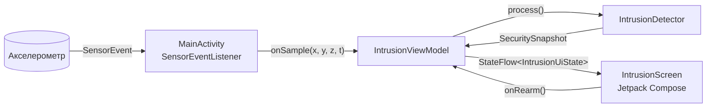
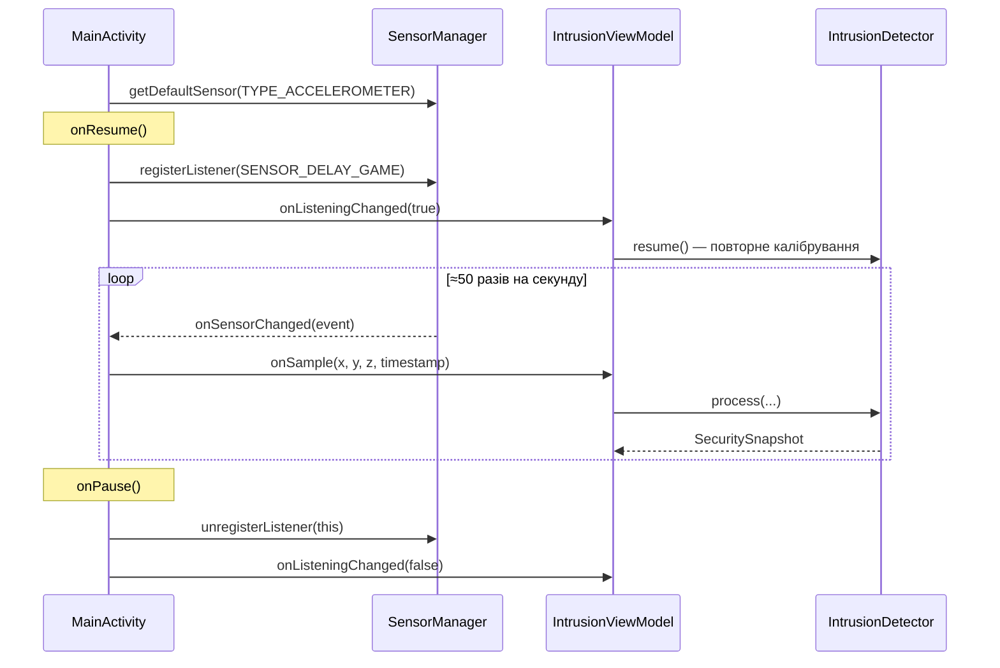
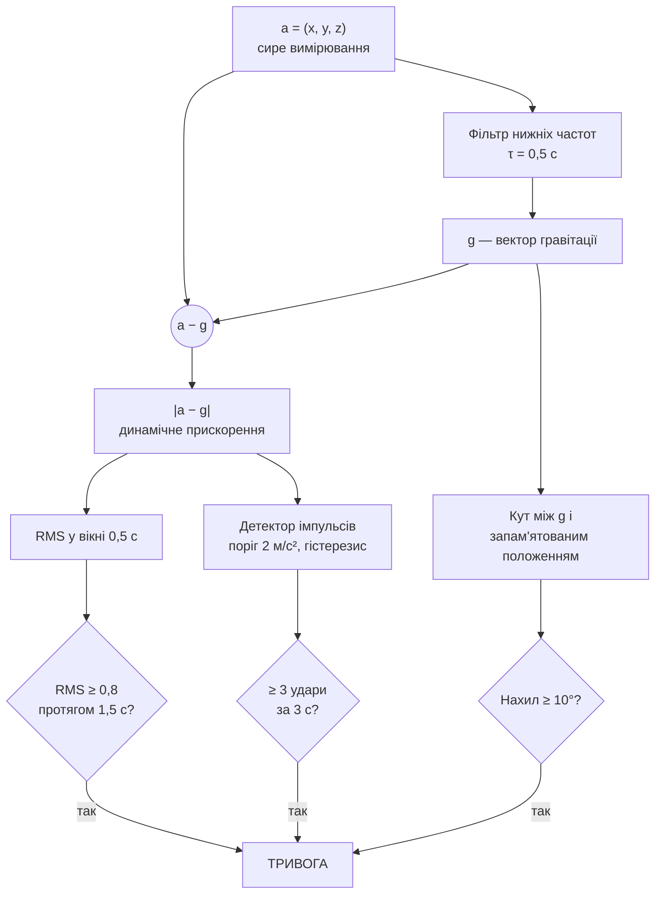
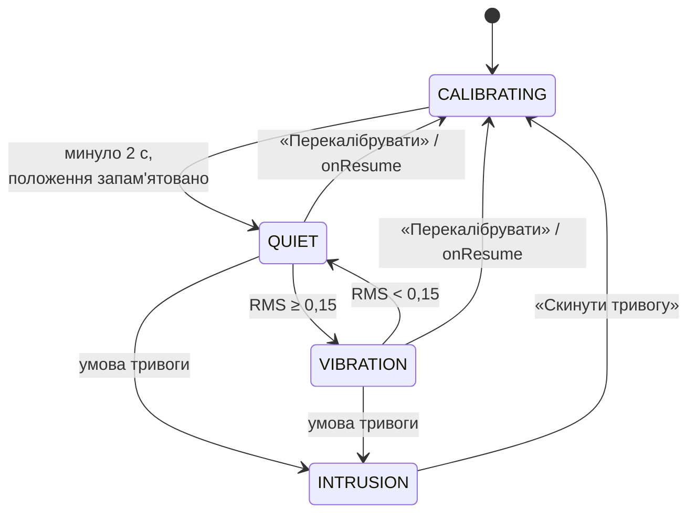

# Intrusion Detector

Android-застосунок, який перетворює смартфон на датчик вторгнення. Телефон кладуть на поверхню (полицю, підвіконня, сейф) або кріплять на двері, і він через акселерометр стежить за вібрацією, ударами та зміною положення. Якщо двері відчинили, у них стукають або телефон зсунули, вмикається тривога.

> Лабораторна робота №1 з курсу мобільної розробки, варіант 13: моніторинг вібрації поверхонь.
> Виконала Покорна Надія.

## Можливості

- Зчитування акселерометра через `SensorManager` з частотою ≈50 Гц
- Відображення X, Y, Z у реальному часі з індикаторами по кожній осі
- Індикатор положення у вигляді «рівня» з межею допустимого нахилу
- Шкала рівня вібрації та графік сигналу за останні ~3 с
- Три незалежні умови тривоги: серія ударів, тривала вібрація, зміна нахилу
- Журнал подій
- Зупинка зчитування в `onPause` для економії батареї
- Збереження стану при повороті екрана
- Unit-тести алгоритму без емулятора

## Технології

| | |
|---|---|
| Мова | Kotlin 2.0 |
| UI | Jetpack Compose, Material 3 |
| Min SDK | 31 (Android 12) |
| Target SDK | 35 |
| Стан | ViewModel + StateFlow |
| Тести | JUnit 4 |

## Структура проєкту

```
app/src/main/java/com/example/intrusiondetector/
├── MainActivity.kt            # SensorManager, SensorEventListener, життєвий цикл
├── IntrusionViewModel.kt      # стан екрана, журнал подій
├── sensor/
│   └── IntrusionDetector.kt   # алгоритм виявлення (чистий Kotlin, без Android)
└── ui/
    ├── IntrusionScreen.kt     # екран на Compose
    └── theme/Theme.kt         # кольори станів і осей

app/src/test/java/com/example/intrusiondetector/sensor/
└── IntrusionDetectorTest.kt   # тести алгоритму на синтетичних сигналах
```

## Архітектура

Код розділений на три шари. Activity працює тільки з Android-сенсором і нічого не знає про логіку. Уся обробка сигналу живе в `IntrusionDetector`, у якому немає жодного імпорту з `android.*`, тому його можна тестувати звичайним JUnit. ViewModel з'єднує їх і переживає поворот екрана.



- **`MainActivity`** отримує `SensorManager`, реєструє слухача і передає `values[0..2]` та `timestamp` у ViewModel.
- **`IntrusionViewModel`** тримає детектор, історію сигналу для графіка (150 точок) і журнал подій (до 20 записів), публікує все це як `StateFlow`.
- **`IntrusionDetector`** на кожне вимірювання повертає `SecuritySnapshot`: значення осей, рівень вібрації, кут нахилу, стан і причину тривоги.
- **`IntrusionScreen`** просто малює те, що прийшло в стані.

## Життєвий цикл сенсора

Слухач реєструється в `onResume` і знімається в `onPause`, тому коли застосунок не на екрані, сенсор не працює і не витрачає батарею.



```kotlin
override fun onResume() {
    super.onResume()
    accelerometer?.let {
        // SENSOR_DELAY_GAME ≈ 50 Гц: достатньо, щоб помітити короткий удар
        sensorManager.registerListener(this, it, SensorManager.SENSOR_DELAY_GAME)
        viewModel.onListeningChanged(true)
    }
}

override fun onPause() {
    // Зупиняємо зчитування, коли застосунок не видно
    sensorManager.unregisterListener(this)
    viewModel.onListeningChanged(false)
    super.onPause()
}
```

Чому саме `SENSOR_DELAY_GAME`: на `SENSOR_DELAY_UI` (~16 Гц) короткий стук може потрапити між двома вимірюваннями і загубитися, а `SENSOR_DELAY_FASTEST` для цієї задачі зайвий.

Після повернення з фону положення калібрується заново, бо поки застосунок був на паузі, телефон могли перекласти. Але якщо тривога вже спрацювала, вона не скидається, інакше її можна було б «прибрати», просто згорнувши застосунок.

## Алгоритм виявлення

### Обробка сигналу

Сирий акселерометр показує не тільки рух, а й гравітацію: у спокої на горизонтальній поверхні Z ≈ 9,81 м/с². Тому сигнал спочатку розділяється на дві складові: повільну (гравітація, тобто положення) і швидку (вібрація).



**1. Виділення гравітації.** Фільтр нижніх частот першого порядку по кожній осі:

```
g ← g + α · (a − g),    α = dt / (τ + dt)
```

`dt` береться з різниці `event.timestamp`, а не константою, бо реальний інтервал між подіями «плаває» навіть при фіксованому `SENSOR_DELAY_*`.

**2. Динамічне прискорення.** `|a − g|` — це вібрація в будь-якому напрямку, незалежно від того, як лежить телефон.

**3. Рівень вібрації.** Середньоквадратичне значення `|a − g|` у ковзному вікні 0,5 с. Сума квадратів оновлюється інкрементно: нове значення додається, застарілі віднімаються, тому прохід по всьому вікну на кожну подію не потрібен.

**4. Імпульси (удари).** Удар фіксується, коли `|a − g|` перевищує 2 м/с². Після сильного удару сигнал ще кілька разів «дзвенить» вище порогу, тому стоїть два обмеження:
- гістерезис: наступний імпульс можливий лише після того, як сигнал впаде нижче 0,5 м/с²;
- мінімум 150 мс між імпульсами.

**5. Нахил.** Перші 2 секунди після постановки на охорону вимірювання усереднюються, і нормований вектор запам'ятовується як базове положення. Далі рахується кут між ним і поточним `g`:

```
θ = arccos( ĝ_base · ĝ_now )
```

### Стани системи



| Стан | Колір | Що означає |
|---|---|---|
| `CALIBRATING` | синій | запам'ятовується положення, тривоги не перевіряються |
| `QUIET` | зелений | поверхня нерухома |
| `VIBRATION` | жовтий | є вібрація, але умови тривоги ще не виконані |
| `INTRUSION` | червоний | тривога, утримується до ручного скидання |

### Порогові значення

Усі пороги зібрані в об'єкті `Thresholds` в `IntrusionDetector.kt`.

| Параметр | Значення | Звідки взялося |
|---|---|---|
| `VIB_WARN_RMS` | 0,15 м/с² | шум сенсора в спокої ≈ 0,01–0,08 |
| `VIB_ALARM_RMS` | 0,8 м/с² | легкі дотики, кроки поруч — до 0,8 |
| `SUSTAIN_NS` | 1,5 с | відкриття дверей триває довше за випадковий поштовх |
| `IMPULSE_PEAK` | 2,0 м/с² | стук у двері дає 2–10 |
| `IMPULSE_RESET` | 0,5 м/с² | гістерезис для імпульсів |
| `MIN_IMPULSE_INTERVAL_NS` | 150 мс | відсікає «дзвін» одного удару |
| `IMPULSE_COUNT` / `IMPULSE_WINDOW_NS` | 3 за 3 с | один-два випадкові удари не рахуються |
| `TILT_ALARM_DEG` | 10° | двері, що відчиняються, або зсунутий телефон |
| `GRAVITY_TAU_S` | 0,5 с | стала часу фільтра гравітації |
| `CALIBRATION_NS` | 2 с | час на запам'ятовування положення |

Пороги поки підібрані на емуляторі та тестових сигналах, на реальному пристрої їх ще треба буде уточнити.

## Інтерфейс

Екран складається з карток, усі графічні елементи намальовані на Compose `Canvas`:

1. **Статус** — кольоровий бейдж стану, причина тривоги, лічильник ударів, кнопка «Перекалібрувати» / «Скинути тривогу». Під час калібрування показується прогрес.
2. **Рівень вібрації** — шкала із зонами «тихо / вібрація / сильна» і маркером поточного RMS.
3. **Координати акселерометра** — X, Y, Z з двосторонніми індикаторами (вліво для від'ємних значень, вправо для додатних) у діапазоні ±2g, а також `|a|` і `|a − g|`.
4. **Положення поверхні** — «рівень»: кулька котиться в бік нахилу, кільце показує запам'ятоване положення, червоне пунктирне коло — межу тривоги 10°.
5. **Сигнал** `|a − g|` за ~3 с з пунктирними лініями порогів.
6. **Журнал подій** — останні 8 записів.
7. **Таблиця порогів.**

<!-- скриншоти додам у docs/screenshots -->
| Калібрування | Тихо | Нахил | Тривога |
|---|---|---|---|
|  |  |  |  |

## Запуск

1. Відкрити проєкт в Android Studio.
2. Запустити на емуляторі або пристрої з Android 12+ (API 31+).
3. Залишити пристрій нерухомим на 2 секунди, поки йде калібрування.

### Перевірка в емуляторі

1. На бічній панелі емулятора натиснути **…** (Extended Controls) → **Virtual Sensors**.
2. На вкладці **Device Pose** обертати модель телефона або рухати повзунки Yaw / Pitch / Roll.
3. Що можна перевірити:
   - **нахил** — плавно змінити Pitch або Roll більше ніж на 10°, спрацює тривога «зміна нахилу»;
   - **удари** — кілька разів різко смикнути повзунок туди-назад, на графіку з'являться піки, а на третьому за 3 с увімкнеться тривога;
   - **життєвий цикл** — згорнути застосунок і повернутися: у журналі з'являться записи про паузу та повторне калібрування.

Справжню вібрацію в емуляторі зробити складно, тому ці сценарії додатково покриті тестами.

## Тести

```bash
./gradlew test
```

`IntrusionDetectorTest` подає в детектор синтетичний сигнал 50 Гц із шумом ±0,03 м/с² (`Random(42)`, щоб результат був відтворюваним) і перевіряє:

| Тест | Сценарій | Очікування |
|---|---|---|
| `calibration_thenQuiet` | 3 с спокою | калібрування → `QUIET`, базове положення ≈ (0, 0, 1) |
| `stillSurface_noAlarm` | 10 с спокою | жодної тривоги, 0 ударів |
| `lightVibration_isWarningOnly` | синус 15 Гц, 0,4 м/с² | `VIBRATION`, без тривоги |
| `twoKnocks_noAlarm` | 2 удари по 5 м/с² | 2 імпульси, без тривоги |
| `threeKnocks_triggerKnocksAlarm` | 3 удари за 2,4 с | `INTRUSION`, причина `KNOCKS`, рівно одне спрацювання |
| `sustainedStrongVibration_triggersAlarm` | 1 с вібрації, пауза, 3 с вібрації | перша — без тривоги, друга — `SUSTAINED_VIBRATION` |
| `smallTilt_noAlarm` | поворот на 5° | без тривоги, кут 4–6° |
| `largeTilt_triggersTiltAlarm` | поворот на 20° | `TILT` |
| `alarm_isLatched_untilArm` | тривога, потім спокій | тривога тримається до `arm()` |
| `resume_recalibrates_butKeepsAlarm` | `resume()` | без тривоги — калібрування, з тривогою — `INTRUSION` лишається |
| `classify_usesThresholdBoundaries` | граничні значення | правильна межа між `QUIET` і `VIBRATION` |

## Плани

Проєкт буде розвиватися протягом семестру:

- фонова служба, щоб охорона працювала з вимкненим екраном;
- сповіщення та звуковий сигнал при тривозі;
- налаштування чутливості користувачем;
- збереження журналу подій;
- підбір порогів на реальному пристрої.
